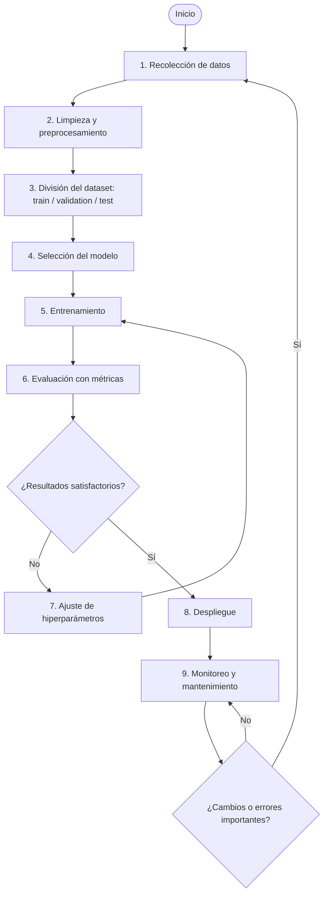

# Actividad Integradora 3.1
## Tipos de aprendizaje automático
### Sección 2. Modelados — 2.2 Diagrama de flujo del ciclo de vida de un modelo de ML

> **Tema:** Del dato al bien social: modelos de IA para transformar realidades.

## 2.2.1 Introducción

El ciclo de vida de un modelo de aprendizaje automático (Machine Learning o ML) reúne las etapas necesarias para convertir datos en un modelo capaz de realizar predicciones o apoyar decisiones. El proceso no termina con el entrenamiento: también requiere evaluación, despliegue, monitoreo y mantenimiento. Es iterativo, porque los resultados de la evaluación pueden indicar que es necesario ajustar el modelo y entrenarlo nuevamente.

## 2.2.2 Diagrama de flujo

## 2.2.3 Descripción de etapas y herramientas

| Etapa | Descripción | Ejemplos de herramientas |
|---|---|---|
| **1. Recolección de datos** | Obtener información pertinente para el problema desde archivos, bases de datos, sensores, formularios o fuentes públicas. Se debe verificar que su uso esté autorizado. | CSV, SQL, APIs, Kaggle y repositorios de datos abiertos. |
| **2. Limpieza y preprocesamiento** | Corregir errores, eliminar duplicados, tratar valores faltantes y transformar los datos a un formato adecuado. También pueden normalizarse variables y codificarse categorías. | Python, pandas, NumPy y scikit-learn. |
| **3. División del dataset** | Separar los datos en entrenamiento, validación y prueba. Entrenamiento sirve para aprender; validación para comparar configuraciones; prueba para estimar el desempeño final con datos reservados. | `train_test_split` de scikit-learn, pandas y NumPy. |
| **4. Selección del modelo** | Elegir un algoritmo según el objetivo: clasificación, regresión, agrupamiento u otra tarea. | scikit-learn, TensorFlow y PyTorch. |
| **5. Entrenamiento** | Utilizar los datos de entrenamiento para ajustar los parámetros internos y aprender patrones. | scikit-learn, TensorFlow, Keras y PyTorch. |
| **6. Evaluación (métricas)** | Medir el desempeño con datos no usados para ajustar el modelo. Se eligen métricas adecuadas al problema y se analizan los errores. | `classification_report`, `confusion_matrix` y `sklearn.metrics`. |
| **7. Ajuste de hiperparámetros** | Modificar configuraciones como la profundidad de un árbol, el número de vecinos o la tasa de aprendizaje. Se busca mejorar sin sobreajustar. | `GridSearchCV`, `RandomizedSearchCV` y Optuna. |
| **8. Despliegue (deployment)** | Integrar el modelo aprobado en una aplicación o servicio para procesar datos nuevos. Se deben cuidar la seguridad y disponibilidad. | FastAPI, Flask, Docker, AWS, Azure y Google Cloud. |
| **9. Monitoreo y mantenimiento** | Revisar precisión, errores, tiempos de respuesta y cambios en los datos. Si el desempeño disminuye, puede ser necesario investigar y volver a entrenar. | MLflow, Evidently AI, logs y paneles de monitoreo. |

## 2.2.4 Importancia de dividir los datos

- **Train (entrenamiento):** conjunto utilizado para ajustar los parámetros del modelo.
- **Validation (validación):** ayuda a comparar modelos y ajustar hiperparámetros.
- **Test (prueba):** se reserva para estimar el desempeño final. No debe utilizarse durante el ajuste, para evitar una evaluación engañosa.

La proporción depende del tamaño y las características del dataset; no existe una división única adecuada para todos los proyectos.

## 2.2.5 Ejemplo de aplicación

Una institución desea clasificar correos como legítimos o no deseados:

1. Recopila correos que puedan utilizarse legalmente y protege los datos personales.
2. Limpia textos y elimina registros duplicados.
3. Separa los mensajes en entrenamiento, validación y prueba.
4. Selecciona un algoritmo de clasificación.
5. Entrena el modelo con los ejemplos etiquetados.
6. Evalúa con precisión, recall y F1.
7. Ajusta hiperparámetros si los resultados no son adecuados.
8. Integra el modelo en el sistema de correo.
9. Monitorea los errores y cambios en los mensajes para decidir si debe actualizarse.

## 2.2.6 Conclusión

El ciclo de vida de ML organiza el desarrollo desde la obtención de datos hasta el mantenimiento. Todas las etapas influyen en la calidad: datos deficientes, una división incorrecta o una evaluación inadecuada pueden provocar resultados poco confiables. Por ello, el proceso debe ser iterativo y considerar privacidad, seguridad y supervisión humana.

## 2.2.7 Declaración de uso de inteligencia artificial

Se utilizó ChatGPT (OpenAI) como apoyo para organizar la información, explicar las etapas y estructurar el diagrama. El contenido debe revisarse y comprenderse antes de entregarlo.

## 2.2.8 Referencias

- Google for Developers. (s. f.). *Machine learning crash course*. https://developers.google.com/machine-learning/crash-course
- scikit-learn developers. (s. f.). *Common pitfalls and recommended practices*. https://scikit-learn.org/stable/common_pitfalls.html
- scikit-learn developers. (s. f.). *Model selection and evaluation*. https://scikit-learn.org/stable/model_selection.html
- TensorFlow. (s. f.). *TensorFlow guide*. https://www.tensorflow.org/guide
